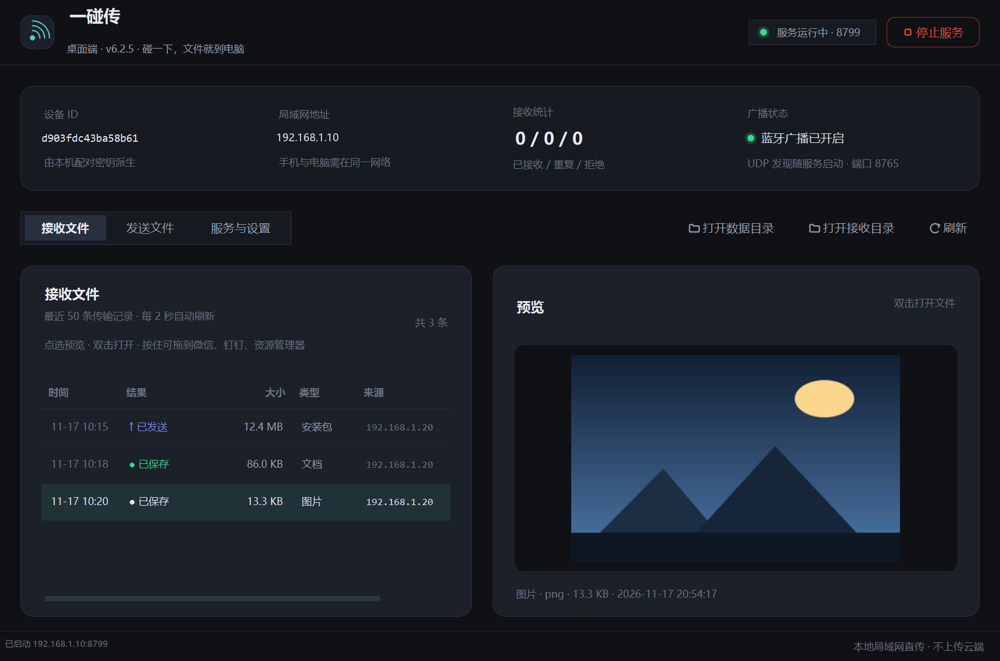
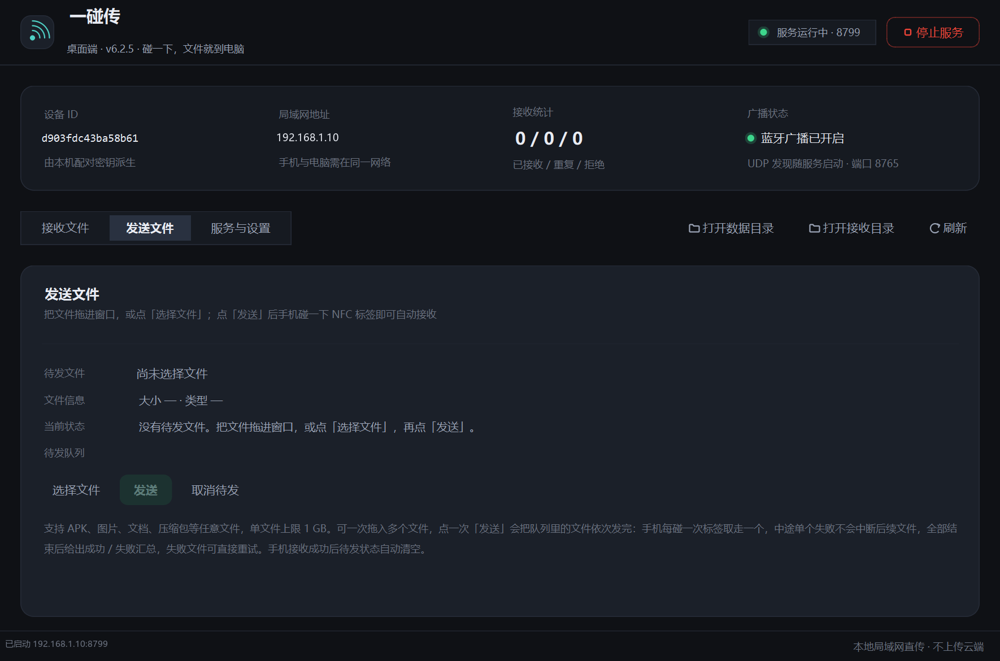
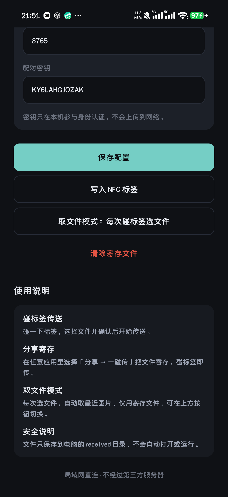
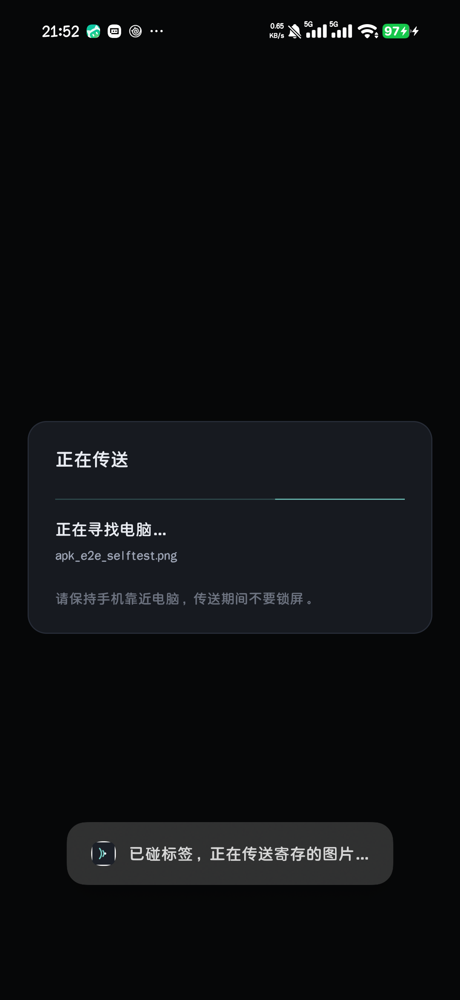
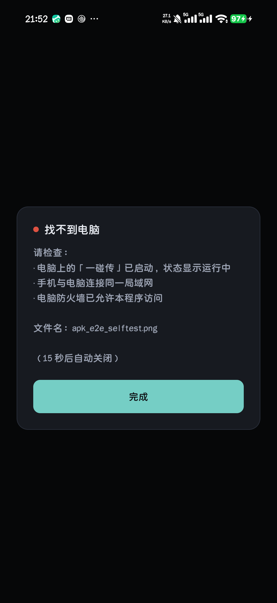

# 一碰传 · NfcTapLink

[](https://github.com/CC2027MK2/NfcTapLink/actions/workflows/build-android.yml)

碰一下 NFC 标签，文件就在手机和电脑之间流动。

- 手机碰标签：把照片、文档、APK 等任意文件传到电脑，电脑上立刻可见、可预览、可直接拖进微信 / 钉钉。
- 电脑碰标签：把电脑上待发的文件队列逐个传到手机，碰几次就传几个。
- 全程局域网直连（HTTP + UDP 组播 + BLE 广播），不经过任何第三方服务器。



## 功能

- **双向传送**：手机 → 电脑、电脑 → 手机都支持；电脑端支持一次拖入多个文件排队，手机每碰一次取走一个。
- **自动发现**：标签里不写死 IP。桌面端同时做 UDP 组播/广播与 BLE 广播，手机按「标签候选 → 缓存地址 → BLE → UDP 组播 → 子网扫描」逐级寻找电脑，换 Wi-Fi、换网段都能用。
- **配对与加密**：配对密钥只存在于标签与电脑本机；`/api/pair` 做双向挑战应答，上传内容做应用层加密与防篡改校验，带防重放与非可信路径过滤。
- **接收即预览**：桌面端左侧是最近传输记录，右侧直接预览图片；其它类型显示类别、大小与修改时间，双击打开。
- **拖出**：已保存的文件可以直接从表格拖到微信、钉钉、资源管理器。
- **零第三方依赖**：桌面端只用 Python 标准库 + PySide6；Android 端纯 Java + Android SDK。

## 截图

| 桌面端 · 发送 | 手机端 · 主界面 |
| --- | --- |
|  |  |

| 手机端 · 传送中 | 手机端 · 结果 |
| --- | --- |
|  |  |

## 目录结构

```
desktop/                    桌面端（Python + PySide6）
  desktop_app.py            主窗口与三页签界面
  receiver.py               HTTP 服务、配对、加密上传、传输日志
  discovery.py              UDP 自动发现
  ble_announcer.py          BLE 广播发现（WinRT）
  hotspot.py                移动热点（Windows ICS）
  write_tag.py              NFC 标签写入（PN532）
  desktop_build/            PyInstaller 打包脚本、图标、随包文件
  installer/                Inno Setup 安装脚本
android/                    手机端 Android 工程（Java，零第三方库）
docs/screenshots/           界面截图
```

## 桌面端

### 运行

```bash
python -m pip install -r desktop/requirements.txt
python desktop/desktop_app.py
```

首次启动会在本机数据目录生成随机配对密钥：

- 默认 `%LOCALAPPDATA%\NfcTapLink\config.json`
- 也可以用 `--data-dir <目录>` 指定别的位置

密钥只存本机，不随源码或安装包分发。换密钥后需要重新写标签。

### 打包

```bash
cd desktop/desktop_build
pyinstaller NfcTapLink.spec          # 产物：desktop_build/dist/NfcTapLink
ISCC ../installer/NfcTapLink.iss     # 产物：desktop_build/dist_installer_v21/
```

安装包会把 `desktop_build/payload/` 下的手机端 APK 与说明一起带上。`payload/NfcTapLink.apk`
是随包的手机端安装包；如需最新版，用 `android/` 源码重新构建后覆盖即可。

## 手机端

要求 JDK 17、Android SDK 34、Gradle 8.7（AGP 8.5.2）。

签名材料不入库，构建前在 `android/` 下自备：

```properties
# android/keystore.properties
storeFile=release.keystore
storePassword=你的口令
keyAlias=你的别名
keyPassword=你的口令
```

```bash
cd android
gradle assembleRelease
```

`android/app/build.gradle` 只在 `keystore.properties` 存在时启用 release 签名配置，
没有该文件时仍可编译 debug 包做本地调试。

## 安全模型

- 标签里写的是 `device_id = sha256(pair_key)[:16]` 与配对密钥；`device_id` 是公开标识，密钥不是。
- 发现公告没有签名，攻击者可以伪造，但拿不到标签里的密钥就算不出 `server_proof`，手机会拒绝它。
- 上传内容用密钥派生材料做应用层加密与 HMAC 校验，并带时间窗与去重，防止重放与篡改。
- 接收目录只保存文件，不会自动打开或执行；危险类型不会直接运行。
- 配置、传输日志、接收文件全部留在本机，不上传云端。

## 隐私

- 仓库不含任何真实配对密钥、签名私钥或运行日志。
- 传输日志 `transfer.log.jsonl`、接收目录 `received/`、发送队列 `outbox/` 都在本机数据目录，已在 `.gitignore` 中排除。
- 截图中的 IP、设备 ID 与配对密钥均为演示数据。

## 版本

- 桌面端：6.2.5
- 手机端源码：6.2.5（`versionCode 15`）

## 许可证

本项目以 [MIT 许可证](LICENSE) 发布，版权归 NfcTapLink contributors 所有。

你可以自由使用、修改、分发，也可以用于商业用途，只需在副本或重要部分中保留版权声明与许可声明；软件按「原样」提供，不附带任何担保。
